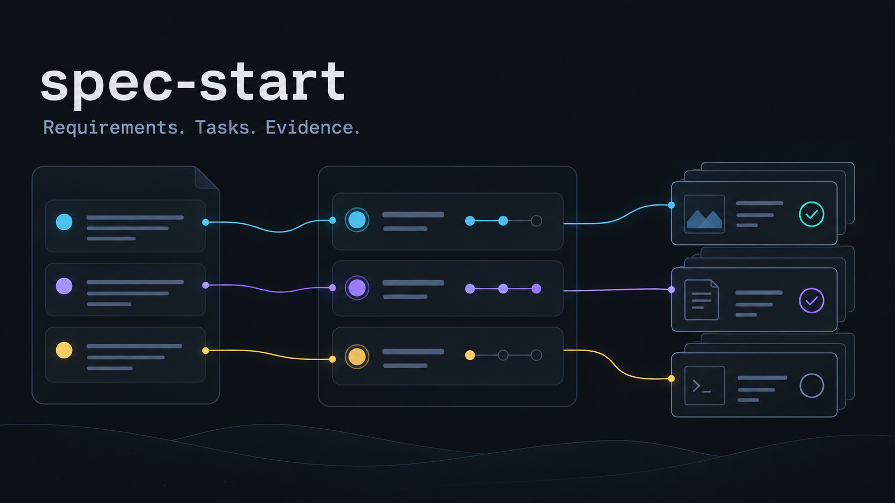

# spec-start · Spec启动！



**让规格帮助完成目标，让每一项完成状态都有对应证据。**

一个面向 Codex 的项目管理 skill，适用于新项目启动和现有项目的 Spec 整理。把用户需求、实施任务与验收材料连起来，减少重复维护状态，保留需求解释和决策依据。

[Skill入口](SKILL.md) · [字段与状态约定](references/format.md) · [管理脚本](scripts/spec_manager.py) · [回归测试](scripts/test_spec_manager.py)

## 核心思路

从用户真实目标建立需求，再让实施与验证围绕这些需求推进：

**用户目标 → 稳定需求编号 → 可执行任务 → 实现与证据 → 验收状态**

例如“生成一份可以读取的完整数据集”：代码写完、作业结束、抽样可读，分别覆盖不同范围。需求的完成判断应指向完整交付和对应证据。记录也可以诚实地保持失败、部分通过或待人工验收。

适用于研究、数据、软件和工程项目。小改动可以只更新对应需求与任务；已有等价 Spec 结构可以直接接入。

## 提供什么

| 能力 | 作用 |
|---|---|
| 启动项目规格 | 整理目标、范围、交付物和成功定义 |
| 接入已有项目 | 保留旧记录，定位当前有效需求与活动入口 |
| 连接实施任务 | 为任务注明需求编号、实现位置、验证和停止条件 |
| 管理验收证据 | 检查证据文件、可选SHA-256及JSON字段条件 |
| 派生状态页 | 从需求清单生成当前快照，减少重复维护 |
| 记录需求解释 | 区分已确认含义、实现提议和待确定含义 |

## 安装到 Codex

Windows PowerShell：

```powershell
git clone https://github.com/Songjun113/spec-start.git "$env:USERPROFILE\.codex\skills\spec-start"
```

macOS / Linux：

```bash
git clone https://github.com/Songjun113/spec-start.git ~/.codex/skills/spec-start
```

配置了自定义 `CODEX_HOME` 时，安装到该目录的 `skills/spec-start`。已有同名目录时更新已有副本。重启 Codex 后使用 `$spec-start`，也可直接说“Spec启动！”。

## 使用示例

### 启动新项目

```text
使用 $spec-start，为当前项目开启Spec管理。
根据我的目标整理范围、交付物和验收定义，建立需求编号与任务的对应关系。
先完成框架，再填本阶段的真实任务和已有证据。
```

### 整理已有项目

```text
Spec启动！请读取当前项目的AGENTS.md、入口文档和计划，
接入已有需求管理，保留历史记录，明确本阶段的交付与未解决项。
把一个真实需求连接到实现及已有验收证据。
```

### 继续执行

```text
使用 $spec-start，读取当前Spec状态，选择依赖已满足的下一项任务。
完成后更新对应验收点和证据，刷新状态，说明实际完成范围。
```

## 脚本用法

脚本仅依赖 Python 标准库。以下命令在本仓库根目录运行，将 `path/to/project` 替换为明确选定、已经存在的活动项目目录。

```bash
python -X utf8 scripts/spec_manager.py init --root path/to/project --name "项目名称"
python -X utf8 scripts/spec_manager.py check --root path/to/project
python -X utf8 scripts/spec_manager.py refresh --root path/to/project
```

| 命令 | 实际行为 |
|---|---|
| `init` | 建立缺失的Spec文件，向PROJECT.md与AGENTS.md添加或更新短导航，生成状态页 |
| `check` | 核对需求结构、依赖关系、任务引用及已指定的证据条件 |
| `refresh` | 检查通过后，从requirements.json重新生成spec/status.md |

`init` 会写入所选项目，适用于已经授权开启或迁移管理的任务。模板初始化后还要填入实际需求；空模板不能说明项目完成。已有Spec文件保留，导航以受管理标记更新。

## 项目中生成的结构

```text
project/
├── PROJECT.md                  # 项目入口与Spec导航
├── AGENTS.md                   # 已有约束及Spec导航
└── spec/
    ├── project.md              # 目标、范围与阶段依赖
    ├── requirements.json       # 当前需求与验收状态的真源
    ├── tasks.md                # 可执行任务
    ├── decisions.md            # 解释与变更依据
    └── status.md               # 派生快照
```

需求状态包括 `planned`、`in_progress`、`awaiting_user`、`blocked`、`verified` 和 `deferred`。验收点分别记录 `pending`、`partial`、`failed` 或 `verified`。具体字段见 [格式约定](references/format.md)。

## 证据怎样参与验收

一个验收点可以连接可读取文件，并指定JSON字段条件：

```json
{
  "path": "experiments/example/audit.json",
  "kind": "audit",
  "scope": "本次完整数据的读取一致性",
  "check": {"field": "passed", "equals": true}
}
```

检查器核对结构和显式条件。它不会自动证明研究效果、语义正确性、物理安全或人工验收。`verified` 需求需要明确含义、全部验收点通过且证据可读取；最终验收仍需结合证据覆盖范围判断。

开启Spec管理只授权管理文件整理。训练、大作业、发布、付费服务、对外消息及Codex goal由用户另行授权。

## 验证

```bash
python -X utf8 -m unittest discover -s scripts -p test_spec_manager.py -v
```

已有7项测试覆盖重复初始化与旧文档保留、未完成需求、缺少证据、失败审计、证据哈希变化、依赖循环及未知任务引用、跳过前置依赖。

## 许可与插图

原创文字与代码采用 [MIT License](LICENSE)。README插图由内置 image-gen 生成，表达需求、任务与证据的对应关系；[提示词](docs/banner-prompt.md)随仓库提供。本项目为独立Codex技能包。
